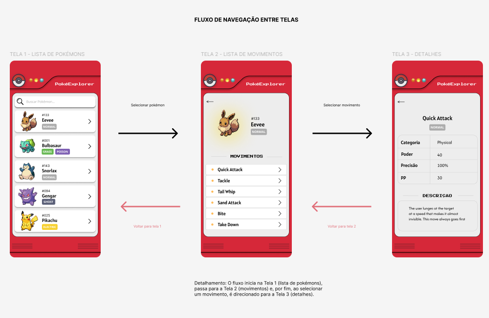
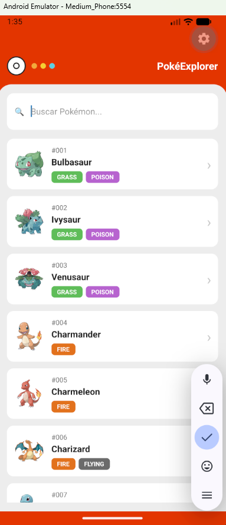
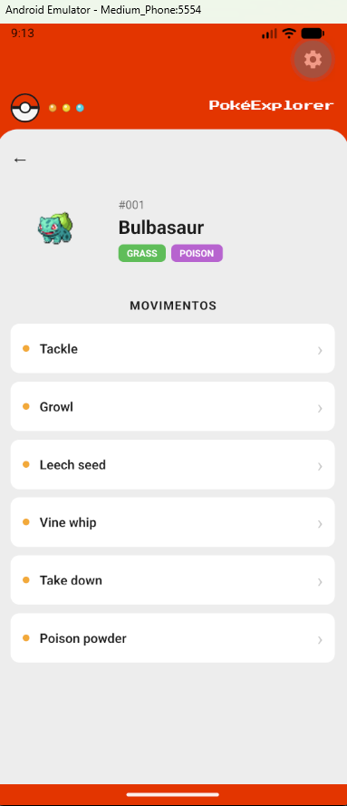
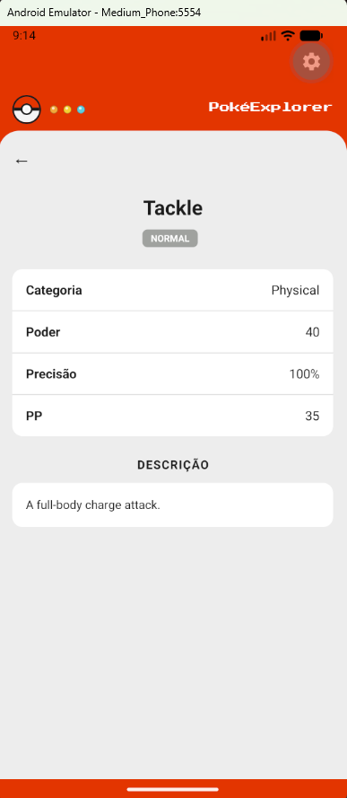

# PokéExplorer

Aplicativo mobile de Pokédex desenvolvido com **React Native** e **Expo**, como trabalho acadêmico da graduação em Análise e Desenvolvimento de Sistemas (PUCRS). O app consome a [PokéAPI](https://pokeapi.co/docs/v2) para listar Pokémon, mostrar os movimentos de cada um e detalhar cada movimento.

> Projeto avaliado em duas fases: na **Fase 1** foram criados os protótipos de 3 telas e, na **Fase 2**, esses protótipos foram transformados em um aplicativo funcional.

## Do protótipo ao app

### Protótipo (Fase 1)

O protótipo define as 3 telas e o fluxo de navegação entre elas:



### App funcional (Fase 2)

| Tela 1 - Lista de Pokémon | Tela 2 - Movimentos do Pokémon | Tela 3 - Detalhes do movimento |
| --- | --- | --- |
|  |  |  |

## Funcionalidades

- **Tela 1 - Lista de Pokémon:** lista de Pokémon com número, imagem, nome e tipos, e campo de busca por nome.
- **Tela 2 - Movimentos do Pokémon:** ao tocar em um Pokémon, mostra a imagem, o número, o nome, os tipos e a lista de movimentos dele.
- **Tela 3 - Detalhes do movimento:** ao tocar em um movimento, mostra o tipo, a categoria, o poder, a precisão, o PP e a descrição.
- Botão de voltar nas telas 2 e 3.
- Dados carregados da PokéAPI.

### Navegação

```
Lista de Pokémon  ->  Movimentos do Pokémon  ->  Detalhes do movimento
```

Em cada tela é possível voltar para a anterior.

## Tecnologias utilizadas

- [React Native](https://reactnative.dev/) com [Expo](https://expo.dev/)
- [React Navigation](https://reactnavigation.org/) (Native Stack) para a navegação entre as telas
- [PokéAPI](https://pokeapi.co/docs/v2) como fonte dos dados
- [Press Start 2P](https://fonts.google.com/specimen/Press+Start+2P) (`@expo-google-fonts/press-start-2p`) para a fonte do título
- `react-native-svg`, `react-native-screens` e `react-native-safe-area-context`

## Estrutura do projeto

```
PokeExplorer/
├── assets/        # imagens e arquivos do app
├── components/    # componentes reutilizáveis
├── navigation/    # configuração da navegação entre as telas
├── screens/       # as telas do app
├── services/      # comunicação com a PokéAPI
├── App.js         # componente principal
├── app.json       # configurações do Expo
├── index.js       # ponto de entrada
└── package.json   # dependências e scripts
```

## Como rodar o projeto

### O que você precisa ter instalado

- [Node.js](https://nodejs.org/)
- [VS Code](https://code.visualstudio.com/)
- Android Studio com um emulador Android criado (ou o app Expo Go em um celular)

### Passo a passo

Todos os comandos abaixo devem ser executados no **terminal do VS Code** (menu `Terminal` > `Novo Terminal`).

1. Baixe o projeto:

   ```
   git clone https://github.com/vilinmon/PokeExplorer.git
   ```

2. Entre na pasta do projeto:

   ```
   cd PokeExplorer
   ```

3. Instale as dependências:

   ```
   npm install
   ```

4. Abra o emulador Android pelo Android Studio e deixe-o ligado.

5. Inicie o app:

   ```
   npm start
   ```

6. Com o servidor rodando, pressione a tecla `a` no terminal para abrir o app no emulador Android.

## Vídeo de demonstração

- Demonstração do app: https://youtu.be/-w0YK894wDc

## Autoria

Desenvolvido por **Evelyn Charupa Nascimento**, aluna de Análise e Desenvolvimento de Sistemas da PUCRS.

## Licença

Distribuído sob a licença MIT. Veja o arquivo [LICENSE](LICENSE).
